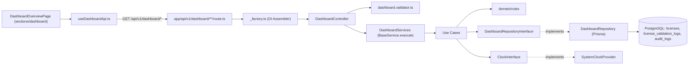

# feat(dashboard): Modul Dasbor Ringkasan Eksekutif, Chart Analitik & Aktivitas Lisensi (Hexagonal + Atomic Design, Light Mode)

## Metadata
- **Issue ID:** `ISSUE-006`
- **Epic:** Dashboard Admin — Phase 4 (`PLANNING.md` §5)
- **Bounded Context:** `src/modules/dashboards/` (baru), `src/modules/licenses/` (penambahan pencatatan log validasi)
- **UI Section:** `src/sections/dashboard/`
- **Route:** `src/app/(protected)/dashboard/page.tsx`
- **Requirement Terkait:** FR-04, FR-06, NFR-01, NFR-03, NFR-04, NFR-05 (`REQUIREMENT.md`)
- **Priority:** High
- **Status:** Ready for Development

---

## 📌 Ringkasan Masalah (Context & Problem Statement)

Sidebar navigasi dan layout terproteksi sudah selesai (PR #19), tetapi **modul Dasbor belum ada**:

1. **Halaman `/dashboard` belum punya konten sendiri.** `src/app/(protected)/dashboard/page.tsx` hanya merender ulang `LicenseManagementPage`, yang memakai data hardcode `INITIAL_LICENSES`.
2. **Belum ada Bounded Context `dashboards`.** Metrik KPI saat ini menumpang di modul `auth` (`GetPortalTelemetryUseCase` / `GET /api/v1/auth/telemetry`), padahal endpoint itu dibuat untuk halaman login publik.
3. **Belum ada data untuk chart.**
   - `ValidateLicenseUseCase` **tidak mencatat** percobaan validasi dari `aksaventra_engine.exe`, sehingga tren validasi (sukses / ditolak / hardware mismatch) tidak memiliki sumber data. Ini juga melanggar **FR-06**.
   - Tabel `validation_logs` yang ada terikat ke `EngineValidation` (registri hash binary #39) lewat `engineValidationId` wajib, serta tidak memiliki `licenseId`, `hwid`, maupun hasil validasi. Tabel ini **tidak cocok** untuk dipakai sebagai sumber chart lisensi.
   - Belum ada komponen chart di `src/shared-ui/component/` dan belum ada library chart di `package.json`.
4. **Badge sidebar** (`AppSidebar.tsx`) membaca telemetri `auth`, padahal seharusnya membaca ringkasan dasbor yang dilindungi izin `DASHBOARD_VIEW`.

Issue ini membangun modul Dasbor secara utuh (KPI, chart, panel aktivitas, tabel) dan **menyiapkan penyimpanan data chart**, mengikuti `AGENTS.md`, `SKILLS.md`, dan `REQUIREMENT.md`: **Route → Controller → Services → UseCase → Repository (Prisma)**, TDD Triple A, Atomic Design, dan Zero Barrel Files.

---

## 🎨 Referensi Desain (Light Mode)

> [!IMPORTANT]
> Dasbor **WAJIB memakai Light Mode** agar konsisten dengan Sidebar, Topbar, dan halaman autentikasi. Palet dark-mode di `DESIGNS.md` (`#121212`, `#00E5FF`) **tidak dipakai**. Yang tetap diikuti dari `DESIGNS.md` hanyalah **prinsip tata letaknya** (§5: chart analitik 8 kolom + panel aktivitas 4 kolom, grid kelipatan 8px, area chart bergradien halus, ikon teknis).

| Token | Nilai Tailwind / Hex |
| :--- | :--- |
| Latar halaman | `bg-slate-50` |
| Permukaan kartu | `bg-white`, `rounded-2xl`, `border border-slate-200/90`, `shadow-sm`, padding `p-5`/`p-6` |
| Warna utama (aksi, seri "Terverifikasi") | `blue-600` / `#2563EB` |
| Positif / Online (seri "Aktivasi Baru") | `emerald-500` / `#10B981` |
| Peringatan (Segera Habis, seri "Kedaluwarsa") | `amber-500` / `#F59E0B` |
| Kritis (Dicabut, seri "Hardware Mismatch") | `rose-500` / `#F43F5E` |
| Netral (seri "Tidak Ditemukan") | `slate-400` / `#94A3B8` |
| Grid chart / sumbu | `#E2E8F0` (`slate-200`) / label `#64748B` (`slate-500`) |
| Angka KPI | `font-extrabold tabular-nums` |
| Tipografi | Plus Jakarta Sans (sudah dipasang di Root Layout) |

### Anatomi Halaman `/dashboard` (Grid 12 Kolom)
```text
┌──────────────────────────────────────────────────────────────────────────────┐
│ AppTopbar: "Ringkasan Eksekutif & Aktivitas Lisensi"  [Cari] [🔔] [+ Buat]    │ ← sudah ada
├──────────────────────────────────────────────────────────────────────────────┤
│ ROW 1 · KPI (3 kol @)                                                         │
│ [Lisensi Aktif] [Segera Habis ≤30H] [Kedaluwarsa / Dicabut] [Utilisasi HWID]  │
├──────────────────────────────────────────────────────────────────────────────┤
│ ROW 2 · 🔔 Peringatan Perpanjangan: Klien A (5 hari lagi), Klien B (12 hari)  │
├───────────────────────────────────────────────────┬──────────────────────────┤
│ ROW 3 · CHART A (8 kol)                            │ PANEL AKTIVITAS (4 kol)  │
│ Tren Validasi Engine  [7H] [30H] [90H]             │ Riwayat Aktivitas Admin  │
│ Area chart bertumpuk: Aktivasi · Terverifikasi ·   │ • Admin menerbitkan …    │
│ Ditolak · Hardware Mismatch                        │ • HWID direset …         │
├─────────────────────────┬─────────────────────────┼──────────────────────────┤
│ ROW 4 · CHART B (4 kol) │ CHART C (4 kol)          │ CHART D (4 kol)          │
│ Distribusi Status       │ Tren Penerbitan &        │ Proyeksi Kedaluwarsa     │
│ Lisensi (Donut)         │ Aktivasi 6 Bulan (Bar)   │ 6 Bulan ke Depan (Bar)   │
├─────────────────────────┴─────────────────────────┴──────────────────────────┤
│ ROW 5 · DAFTAR LISENSI & ALOKASI PERANGKAT TERBARU  [Semua] [Aktif] [Segera…] │
│ Nama Klien │ Kunci (masked) │ Versi Engine │ Status HWID │ Kedaluwarsa │ Status │ Aksi │
│ Menampilkan 1–5 dari N total lisensi terdaftar              ‹ Pagination ›    │
└──────────────────────────────────────────────────────────────────────────────┘
```
Responsif: mobile (`< 768px`) semua blok 1 kolom; tablet (`md`) KPI 2 kolom dan chart 1 kolom; desktop (`lg`) mengikuti grid di atas.

---

## 🗄️ Penyimpanan Data Chart (Perubahan Skema Prisma)

### Model Baru: `LicenseValidationLog`
Model ini mencatat **setiap** permintaan `POST /api/v1/validate` dan menjadi sumber Chart A (Tren Validasi Engine) sekaligus memenuhi FR-06.

```prisma
enum LicenseValidationResult {
  ACTIVATED       // 200 — Kasus 1: Aktivasi baru, HWID dikunci
  VERIFIED        // 200 — Kasus 2: Device terdaftar, HWID cocok
  NOT_FOUND       // 404 — Serial key tidak ditemukan
  EXPIRED         // 401 — Masa berlaku habis
  SUSPENDED       // 401 — Lisensi ditangguhkan / dicabut
  HWID_MISMATCH   // 403 — Kasus 4: Hardware mismatch
  BAD_REQUEST     // 400/401 — Payload tidak lengkap / tidak valid
}

model LicenseValidationLog {
  id             String                  @id @default(uuid())
  licenseId      String?                 @map("license_id")
  license        License?                @relation(fields: [licenseId], references: [id], onDelete: SetNull)
  serialKeyHint  String                  @map("serial_key_hint") // hanya 4 karakter terakhir, bukan serial key penuh
  hwidHash       String?                 @map("hwid_hash")       // SHA-256 dari HWID yang dikirim klien
  result         LicenseValidationResult
  statusCode     Int                     @map("status_code")
  engineVersion  String?                 @map("engine_version")
  clientIp       String?                 @map("client_ip")
  userAgent      String?                 @map("user_agent")
  latencyMs      Int?                    @map("latency_ms")
  checkedAt      DateTime                @default(now()) @map("checked_at")

  @@index([checkedAt])
  @@index([result, checkedAt])
  @@index([licenseId])
  @@map("license_validation_logs")
}

model License {
  // ... kolom yang sudah ada tetap dipertahankan
  validationLogs LicenseValidationLog[]
}
```

> [!CAUTION]
> Demi keamanan, **jangan** menyimpan serial key penuh atau HWID mentah di log. Upaya validasi dengan key palsu juga ikut tercatat, sehingga log tidak boleh berubah menjadi daftar kunci yang bisa dibaca. Simpan `serialKeyHint` (4 karakter terakhir) dan `hwidHash` (SHA-256).

- Migrasi: `npx prisma migrate dev --name add_license_validation_logs --config prisma7.config.ts`.
- Tabel `validation_logs` lama **tidak diubah**, karena tetap dipakai untuk registri integritas binary (#39).

### Pencatatan Log di Modul `licenses` (Prasyarat Chart A)
Agar chart terisi oleh trafik nyata, modul `licenses` harus mencatat setiap hasil validasi:

| Berkas | Perubahan |
| :--- | :--- |
| `licenses/domain/entity/LicenseValidationLogEntity.ts` | **Baru.** Entity berisi `create()`, masking `serialKeyHint`, dan `hwidHash` |
| `licenses/domain/interfaces/LicenseInterfaces.ts` | Tambah port `LicenseValidationLogRepositoryInterface { record(log): Promise<void> }` |
| `licenses/infrastructure/repo/LicenseValidationLogRepository.ts` | **Baru.** Implementasi Prisma `licenseValidationLog.create` |
| `licenses/application/usecase/ValidateLicenseUseCase.ts` | Catat hasil di **setiap** cabang (7 hasil di atas) beserta `latencyMs` |
| `licenses/domain/dto/LicenseRequestDTO.ts` | Tambah metadata request opsional: `clientIp`, `userAgent` |
| `licenses/infrastructure/http/LicenseController.ts` | Teruskan `x-forwarded-for` dan `user-agent` ke service |
| `app/api/v1/validate/_factory` (atau assembler setara) | Injeksi `LicenseValidationLogRepository` |

> [!WARNING]
> Pencatatan log bersifat **best-effort**: kegagalan menulis log **tidak boleh** menggagalkan atau mengubah respons validasi ke `aksaventra_engine.exe` (kontrak FR-03 tetap sama), dan tidak boleh membuat respons melewati batas NFR-01 (< 200 ms).

---

## 📊 Pemetaan Sumber Data (Data Source Mapping)

Semua angka **wajib** berasal dari PostgreSQL melalui `DashboardRepository`, tanpa nilai hardcode di UI. Waktu acuan `now` diambil dari `ClockInterface` di Use Case agar deterministik saat diuji. Seluruh bucket tanggal memakai zona waktu **`Asia/Jakarta` (WIB)**.

### KPI, Banner, Tabel, dan Aktivitas
| Widget | Sumber | Aturan Perhitungan |
| :--- | :--- | :--- |
| **Lisensi Aktif** | `license.count` | `status = ACTIVE` dan (`expiresAt IS NULL` atau `expiresAt > now`) |
| **Tren +x% bulan ini** | `license.count` per `createdAt` | `((bulanIni − bulanLalu) / max(bulanLalu, 1)) × 100`, 1 desimal |
| **Segera Habis (≤30 Hari)** | `license.count` | `status = ACTIVE` dan `now < expiresAt ≤ now + 30 hari` |
| **Kedaluwarsa / Dicabut** | `license.count` | `status IN (EXPIRED, SUSPENDED)` atau (`ACTIVE` dan `expiresAt ≤ now`) |
| **Utilisasi HWID** | `license.count` | `(Aktif dengan hwid NOT NULL) / Lisensi Aktif × 100`; hasilnya `0` jika belum ada lisensi aktif |
| **Banner Perpanjangan** | `license.findMany` | Lisensi Segera Habis, `orderBy expiresAt asc`, `take 2` |
| **Tabel Lisensi Terbaru** | `license.findMany` + `count` | `orderBy createdAt desc`, paginasi `page`/`limit`, filter tab status |
| **Panel Riwayat Aktivitas** | `auditLog.findMany` + `user` | `orderBy createdAt desc`, `take 6` |

### Chart
| Chart | Tipe | Sumber | Seri / Slice | Rentang & Granularitas |
| :--- | :--- | :--- | :--- | :--- |
| **A. Tren Validasi Engine** | Area bertumpuk (gradien) | `license_validation_logs` | `ACTIVATED`, `VERIFIED`, `DITOLAK` (= `NOT_FOUND`+`EXPIRED`+`SUSPENDED`+`BAD_REQUEST`), `HWID_MISMATCH` | `7d` / `30d` → per hari; `90d` → per minggu |
| **B. Distribusi Status Lisensi** | Donut | `licenses` | Aktif, Segera Habis, Kedaluwarsa, Dicabut (`SUSPENDED`) | Snapshot saat ini |
| **C. Tren Penerbitan & Aktivasi** | Bar berkelompok | `licenses.createdAt`, `licenses.activatedAt` | Diterbitkan, Diaktivasi | 6 bulan terakhir, per bulan |
| **D. Proyeksi Kedaluwarsa** | Bar | `licenses.expiresAt` (status `ACTIVE`) | Akan Kedaluwarsa | 6 bulan ke depan, per bulan |

**Aturan agregasi:**
- Agregasi deret waktu dilakukan di `DashboardRepository` dengan `prisma.$queryRaw` (tagged template yang terparameterisasi, **bukan** `$queryRawUnsafe`) memakai `date_trunc('day' | 'week' | 'month', checked_at AT TIME ZONE 'Asia/Jakarta')`.
- Bucket yang tidak punya data **wajib diisi `0`** oleh rule domain `TimeSeriesBucketRule`, agar sumbu-X chart tetap kontinu (tidak ada tanggal yang hilang).
- Respons chart juga menyertakan `totals` per seri untuk legenda (contoh: "Terverifikasi: 1.204").

> [!NOTE]
> **Kolom desain yang belum didukung skema.** Model `License` tidak memiliki `produk`, `paket/tier`, atau `kuota kursi (x/100)`. Pada issue ini kolom "Produk / Paket" diganti **Versi Engine** dan "Penggunaan Kursi" diganti **Status HWID** (1 lisensi = 1 perangkat). Perluasan skema tersebut dicatat di **Keputusan Terbuka**.

---

## 🏗️ Arsitektur Modul (Architect Agent)

### Alur Request


### Struktur Berkas Bounded Context
Struktur ini disamakan dengan modul `auth` (paling lengkap) dan `licenses`: `application/`, `domain/{builders,dto,entity,interfaces,mapper,rules,types,value-object}`, `infrastructure/{http,providers,repo,validators}`, `presentation/{helpers,hooks}`, `shared/constants`, dan `tests/{application,domain,infrastructure,mocks}`.

```text
src/modules/dashboards/
├── application/
│   ├── services/
│   │   └── DashboardServices.ts                  # Fasad orkestrator (extends BaseService)
│   └── usecase/
│       ├── GetDashboardSummaryUseCase.ts         # 4 KPI + tren + utilisasi + banner (expiring)
│       ├── GetRecentLicensesUseCase.ts           # Tabel terbaru + paginasi + filter tab
│       ├── GetRecentActivitiesUseCase.ts         # Panel riwayat aktivitas (audit_logs)
│       ├── GetValidationTrendUseCase.ts          # Chart A
│       ├── GetLicenseStatusDistributionUseCase.ts# Chart B
│       ├── GetIssuanceTrendUseCase.ts            # Chart C
│       └── GetExpiryForecastUseCase.ts           # Chart D
├── domain/
│   ├── builders/
│   │   └── DashboardQueryBuilder.ts              # range(7d|30d|90d), granularity, timezone, paginate — pola AuthQueryBuilder
│   ├── dto/
│   │   ├── DashboardRequestDTO.ts                # RecentLicensesQueryDTO, ChartRangeQueryDTO, ActivitiesQueryDTO
│   │   └── DashboardResponseDTO.ts               # Summary, RecentLicense, Activity, TimeSeriesChart, DistributionChart DTO
│   ├── entity/
│   │   ├── DashboardSummaryEntity.ts             # Aggregate KPI: hasRenewalWarning(), utilizationRate, growthRate
│   │   └── ValidationTrendEntity.ts              # Seri tren validasi + totals + successRate()
│   ├── interfaces/
│   │   ├── DashboardInterfaces.ts                # DashboardRepositoryInterface (port)
│   │   └── ClockInterface.ts                     # now(): Date — agar use case deterministik saat diuji
│   ├── mapper/
│   │   └── DashboardMapper.ts                    # Raw Prisma/SQL → DTO, masking serial key
│   ├── rules/
│   │   ├── LicenseExpiryRule.ts                  # ACTIVE | EXPIRING_SOON | EXPIRED | SUSPENDED
│   │   ├── GrowthRateRule.ts                     # Persentase tren bulanan, aman dari pembagian dengan nol
│   │   ├── ValidationOutcomeGroupingRule.ts      # 7 hasil validasi → 4 seri chart A
│   │   └── TimeSeriesBucketRule.ts               # Isi bucket kosong dengan 0, urutkan kronologis
│   ├── types/
│   │   ├── ChartGranularity.ts                   # "day" | "week" | "month"
│   │   ├── ChartRange.ts                         # "7d" | "30d" | "90d"
│   │   ├── DashboardLicenseState.ts              # "ACTIVE" | "EXPIRING_SOON" | "EXPIRED" | "SUSPENDED"
│   │   └── ValidationTrendSeriesKey.ts           # "activated" | "verified" | "rejected" | "mismatch"
│   └── value-object/
│       ├── ExpiryWindow.ts                       # now → now + N hari (default 30)
│       ├── UtilizationRate.ts                    # 0–100, 1 desimal, menolak input negatif
│       ├── DateRange.ts                          # Rentang start–end valid (start < end), dari ChartRange
│       └── TimeSeriesPoint.ts                    # { bucket: ISO date, label, value ≥ 0 }
├── infrastructure/
│   ├── http/
│   │   └── DashboardController.ts                # Pemetaan Result<T,E> → NextResponse
│   ├── providers/
│   │   └── SystemClockProvider.ts                # Implementasi ClockInterface (new Date())
│   ├── repo/
│   │   └── DashboardRepository.ts                # SATU-SATUNYA tempat pemanggilan Prisma di modul ini
│   └── validators/
│       └── dashboard.validator.ts                # Validasi query — pola license.validator.ts
├── presentation/
│   ├── helpers/
│   │   ├── chartFormatters.ts                    # Label sumbu (id-ID), format angka ringkas (1,2 rb), persen
│   │   └── dashboardViewMapper.ts                # DTO → view model komponen (warna seri, label status)
│   └── hooks/
│       └── useDashboardApi.ts                    # useApiExecutor + apiRequest + unwrapApiResponse
├── shared/
│   └── constants/
│       └── dashboardConstants.ts                 # EXPIRING_SOON_DAYS=30, DEFAULT_CHART_RANGE="30d", DASHBOARD_TIMEZONE="Asia/Jakarta", MAX_PAGE_LIMIT=50
└── tests/
    ├── mocks/
    │   └── mockFactories.ts                      # mock repo, fixed clock, factory raw license & log
    ├── domain/
    │   ├── entity.test.ts
    │   ├── rules.test.ts
    │   ├── value-object.test.ts
    │   └── DashboardQueryBuilder.test.ts
    ├── application/
    │   ├── DashboardServices.test.ts
    │   ├── GetDashboardSummaryUseCase.test.ts
    │   ├── GetRecentLicensesUseCase.test.ts
    │   ├── GetRecentActivitiesUseCase.test.ts
    │   ├── GetValidationTrendUseCase.test.ts
    │   ├── GetLicenseStatusDistributionUseCase.test.ts
    │   ├── GetIssuanceTrendUseCase.test.ts
    │   └── GetExpiryForecastUseCase.test.ts
    └── infrastructure/
        ├── DashboardController.test.ts
        └── DashboardValidator.test.ts
```

### Kontrak Port Repository (rancangan)
```typescript
export interface DashboardRepositoryInterface {
  // KPI & tabel
  countLicenseStates(now: Date, expiringUntil: Date): Promise<LicenseStateCounts>;
  countLicensesCreatedBetween(range: DateRange): Promise<number>;
  findExpiringLicenses(now: Date, expiringUntil: Date, limit: number): Promise<ExpiringLicenseRecord[]>;
  findRecentLicenses(query: RecentLicensesQuery, now: Date): Promise<PaginatedRecords<RecentLicenseRecord>>;
  findRecentActivities(limit: number): Promise<ActivityRecord[]>;

  // Chart
  aggregateValidationOutcomes(range: DateRange, granularity: ChartGranularity, timezone: string): Promise<ValidationOutcomeBucketRecord[]>;
  aggregateLicensesIssued(range: DateRange, timezone: string): Promise<MonthlyCountRecord[]>;
  aggregateLicensesActivated(range: DateRange, timezone: string): Promise<MonthlyCountRecord[]>;
  aggregateLicensesExpiring(range: DateRange, timezone: string): Promise<MonthlyCountRecord[]>;
}
```

### Kontrak DTO Chart (rancangan)
```typescript
export interface TimeSeriesChartResponseDTO<TKey extends string = string> {
  range: ChartRange;                // "30d"
  granularity: ChartGranularity;    // "day"
  timezone: string;                 // "Asia/Jakarta"
  series: Array<{
    key: TKey;                      // "verified"
    label: string;                  // "Terverifikasi"
    total: number;
    points: Array<{ bucket: string; label: string; value: number }>; // bucket ISO "2026-10-29", label "29 Okt"
  }>;
}

export interface DistributionChartResponseDTO {
  total: number;
  slices: Array<{ key: DashboardLicenseState; label: string; value: number; percent: number }>;
}
```

### REST API Endpoint (pola `src/app/api/v1/auth/_factory.ts`)
| Method | Endpoint | Controller | Izin | Respons |
| :--- | :--- | :--- | :--- | :--- |
| `GET` | `/api/v1/dashboard/summary` | `getSummary` | `DASHBOARD_VIEW` | KPI, tren, utilisasi, `expiring[]` |
| `GET` | `/api/v1/dashboard/licenses/recent?status=&page=&limit=` | `getRecentLicenses` | `DASHBOARD_VIEW` | `{ items, total, page, limit, counts }` |
| `GET` | `/api/v1/dashboard/activities?limit=` | `getActivities` | `LOGS_VIEW` | `ActivityDTO[]` |
| `GET` | `/api/v1/dashboard/charts/validation-trend?range=7d\|30d\|90d` | `getValidationTrend` | `DASHBOARD_VIEW` | `TimeSeriesChartResponseDTO` |
| `GET` | `/api/v1/dashboard/charts/license-status` | `getLicenseStatusDistribution` | `DASHBOARD_VIEW` | `DistributionChartResponseDTO` |
| `GET` | `/api/v1/dashboard/charts/issuance-trend` | `getIssuanceTrend` | `DASHBOARD_VIEW` | `TimeSeriesChartResponseDTO` |
| `GET` | `/api/v1/dashboard/charts/expiry-forecast` | `getExpiryForecast` | `DASHBOARD_VIEW` | `TimeSeriesChartResponseDTO` |

```text
src/app/api/v1/dashboard/
├── _factory.ts                       # buildDashboardController(): Repository + Clock → Services → Controller
├── summary/route.ts
├── activities/route.ts
├── licenses/recent/route.ts
└── charts/
    ├── validation-trend/route.ts
    ├── license-status/route.ts
    ├── issuance-trend/route.ts
    └── expiry-forecast/route.ts
```

> [!CAUTION]
> Berkas `route.ts` **dilarang** mengimpor `prisma`. Route hanya memanggil method controller dari `_factory.ts`, sama seperti `src/app/api/v1/auth/telemetry/route.ts`.

---

## 🔐 Keamanan & RBAC (Security & QA Auditor Agent)

| Role | Dasbor, KPI & Chart | Tabel | Tombol "Kelola" / "+ Buat Lisensi Baru" | Panel Aktivitas |
| :--- | :---: | :---: | :---: | :---: |
| `ADMIN` | ✅ | ✅ | ✅ | ✅ |
| `OPERATOR` | ✅ | ✅ | ✅ (sesuai `LICENSES_CREATE`) | ✅ |
| `AUDITOR` | ✅ | ✅ read-only | ❌ disembunyikan | ✅ |

- `src/proxy.ts`: request `/api/v1/dashboard/*` tanpa sesi valid ditolak dengan `401`.
- `src/security/policyEngine.ts`: tambahkan aturan path `/api/v1/dashboard/*` (lihat kolom Izin pada tabel endpoint).
- `DashboardMapper` wajib menyamarkan serial key (`AKSA-••••-••••-9F2A`). `vaultSecret`, HWID lengkap, `hwidHash`, dan `clientIp` **tidak pernah** dikirim ke dasbor.
- Parameter `range`, `status`, `page`, dan `limit` divalidasi dengan whitelist sebelum masuk ke `$queryRaw`.
- Respons error tidak boleh membocorkan detail Prisma/SQL.

---

## 🧩 Atomic UI Sections (Frontend & UI/UX Specialist Agent)

### Komponen Chart Global (`src/shared-ui/component/Chart/`)
Chart bersifat generik, sehingga ditempatkan di design system global (bukan di section) agar bisa dipakai ulang oleh modul lain:

```text
src/shared-ui/component/Chart/
├── AreaChart.tsx        # Area bertumpuk + gradien halus, sumbu & grid slate-200
├── BarChart.tsx         # Bar tunggal / berkelompok
├── DonutChart.tsx       # Donut + label total di tengah
├── ChartLegend.tsx      # Legenda dengan dot warna + total per seri
├── ChartTooltip.tsx     # Tooltip putih rounded-xl shadow
└── ChartEmptyState.tsx  # "Belum ada data pada periode ini"
```
- Library: **`recharts`** (kompatibel React 19). Hanya wrapper di `shared-ui/component/Chart/` yang boleh mengimpor `recharts` langsung.
- Semua komponen chart memakai `"use client"`, menerima `series`/`slices` yang sudah diformat (tanpa fetch), dan memiliki `aria-label` serta ringkasan teks untuk aksesibilitas.

### Section Dasbor (`src/sections/dashboard/`)
```text
src/sections/dashboard/
├── atomic/
│   ├── DashboardKpiCard.tsx            # Label, nilai, ikon, sub-teks berwarna, slot progress bar
│   ├── KpiTrendIndicator.tsx           # "+8.2% bulan ini" (emerald) / negatif (rose)
│   ├── LicenseExpiryBadge.tsx          # Aktif | Segera Habis | Kedaluwarsa | Dicabut
│   ├── MaskedSerialKey.tsx             # Serial key tersamar, font monospace
│   ├── DeviceBindingIndicator.tsx      # Terikat (HWID) / Belum Aktivasi
│   └── ChartRangeToggle.tsx            # [7H] [30H] [90H] — memakai shared-ui ToggleGroup
├── molecules/
│   ├── DashboardKpiGrid.tsx
│   ├── RenewalWarningBanner.tsx
│   ├── ValidationTrendChartCard.tsx    # Card + header + ChartRangeToggle + AreaChart + Legend
│   ├── LicenseStatusDonutCard.tsx      # Card + DonutChart
│   ├── IssuanceTrendChartCard.tsx      # Card + BarChart berkelompok
│   ├── ExpiryForecastChartCard.tsx     # Card + BarChart
│   ├── RecentActivityList.tsx
│   ├── LicenseStatusTabs.tsx
│   └── RecentLicensesTableView.tsx     # shared-ui Table + Pagination
├── organisms/
│   ├── SidebarNavigation.tsx           # (sudah ada)
│   ├── DashboardSummaryOrganism.tsx    # getSummary → KPI Grid + Banner
│   ├── DashboardAnalyticsOrganism.tsx  # getValidationTrend + 3 chart lisensi + getActivities
│   └── RecentLicensesOrganism.tsx      # getRecentLicenses → Tabs + Table
└── pages/
    └── DashboardOverviewPage.tsx       # Diimpor oleh app/(protected)/dashboard/page.tsx
```

**Aturan wajib:**
- Gunakan komponen `src/shared-ui/component/` (`Card`, `Badge`, `Button`, `LinkButton`, `Table`, `Pagination`, `Skeleton`, `ToggleGroup`) dan jangan memakai elemen HTML native mentah untuk input atau aksi.
- Gunakan **named handler** (`handleRangeChange`, `handleTabChange`, `handlePageChange`), tanpa arrow function inline di props JSX.
- Setiap kartu (KPI/chart/tabel) memiliki state **loading** (`Skeleton`), **error** (pesan + tombol "Coba Lagi"), dan **empty** (`ChartEmptyState` / CTA "Terbitkan Lisensi"), yang berjalan independen agar satu chart gagal tidak mengosongkan halaman.
- Tombol "Kelola" disembunyikan jika `canAccess(role, "LICENSES_MANAGE") === false`.
- `src/app/(protected)/dashboard/page.tsx` diganti agar mengimpor `DashboardOverviewPage`.
- Badge sidebar (`AppSidebar.tsx`) dipindahkan dari `useAuthApi().getTelemetry` ke `useDashboardApi().getSummary`.

---

## 🌱 Seeder Data Demo (Backend & TDD Developer Agent)

Agar KPI dan **seluruh chart** langsung terisi saat diverifikasi, tambahkan seeder dengan **data statis (tanpa `process.env`)** dan tanggal **relatif terhadap waktu seeding**:

| Berkas | Isi |
| :--- | :--- |
| `prisma/seed/lib/dateHelpers.ts` | `daysFromNow(n)`, `monthsAgo(n)` |
| `prisma/seed/data/licenses.data.ts` | ≥ 24 lisensi yang tersebar di 6 bulan terakhir (`createdAt`) dan mencakup semua kondisi: aktif terikat, aktif belum aktivasi, segera habis (5 & 12 hari), kedaluwarsa, `SUSPENDED`, serta `expiresAt` tersebar ke 6 bulan ke depan |
| `prisma/seed/data/licenseValidationLogs.data.ts` | Pola **deterministik** (tanpa `Math.random`) untuk 90 hari terakhir dengan campuran 7 hasil validasi |
| `prisma/seed/seeders/licenseSeeder.ts` | `upsert` idempoten berdasarkan `serialKey` |
| `prisma/seed/seeders/licenseValidationLogSeeder.ts` | ID tetap berawalan `seed-vlog-`; seeder hanya menghapus baris berawalan tersebut sebelum `createMany`, agar idempoten tanpa menyentuh log asli |
| `prisma/seed/seed.ts` | Urutan: `seedAdminUsers()` → `seedLicenses()` → `seedLicenseValidationLogs()` |

---

## 📋 Rencana Kerja (Task Checklist)

### Phase 0 — Penyimpanan Data Chart (Architect + Backend Agent)
- [ ] Tambah enum `LicenseValidationResult` dan model `LicenseValidationLog` ke `prisma/schema.prisma`, lalu jalankan migrasi.
- [ ] **TDD:** test `LicenseValidationLogEntity` (masking hint, hash HWID).
- [ ] **TDD:** perbarui `ValidateLicenseUseCase.test.ts` dengan asersi `record()` terpanggil di 7 cabang hasil, dan validasi tetap sukses ketika `record()` melempar error.
- [ ] Implementasikan entity, port, `LicenseValidationLogRepository`, serta perubahan use case, controller, dan factory validasi.

### Phase 1 — Kontrak Domain Dasbor (Architect Agent)
- [ ] Buat `types/`, `dto/`, `interfaces/` (`DashboardRepositoryInterface`, `ClockInterface`), dan `shared/constants/dashboardConstants.ts`.
- [ ] Buat `value-object/`, `rules/`, `entity/`, `builders/DashboardQueryBuilder.ts`, dan `mapper/DashboardMapper.ts`.

### Phase 2 — TDD Use Cases & Services (Backend & TDD Developer Agent)
- [ ] **RED:** tulis unit test Triple A untuk domain dan 7 use case (lihat Skenario Uji).
- [ ] **GREEN:** implementasikan 7 use case (mengembalikan `Result<T, E>`) dan `DashboardServices`.

### Phase 3 — Infrastruktur & API (Backend & TDD Developer Agent)
- [ ] Implementasikan `DashboardRepository`: KPI dengan `Promise.all`, agregasi chart dengan `$queryRaw` terparameterisasi.
- [ ] Implementasikan `SystemClockProvider`, `dashboard.validator.ts`, `DashboardController`, dan `_factory.ts`.
- [ ] Buat 7 berkas `route.ts` sesuai struktur API di atas.
- [ ] Implementasikan `useDashboardApi.ts` (`getSummary`, `getRecentLicenses`, `getActivities`, `getValidationTrend`, `getLicenseStatusDistribution`, `getIssuanceTrend`, `getExpiryForecast`).
- [ ] Buat seeder demo (`dateHelpers.ts`, `licenses.data.ts`, `licenseValidationLogs.data.ts`, dan kedua seeder).

### Phase 4 — Atomic UI & Chart (Frontend & UI/UX Specialist Agent)
- [ ] `npm install recharts`, lalu buat wrapper `src/shared-ui/component/Chart/*`.
- [ ] Buat `presentation/helpers/chartFormatters.ts` dan `dashboardViewMapper.ts`.
- [ ] Buat komponen `atomic/` → `molecules/` → `organisms/` → `pages/`.
- [ ] Ganti `src/app/(protected)/dashboard/page.tsx` dan sumber badge sidebar.
- [ ] Pastikan tampilan responsif pada 375 px, 768 px, dan 1280 px.

### Phase 5 — Keamanan & Quality Gates (Security & QA Auditor Agent)
- [ ] Tambahkan aturan `/api/v1/dashboard/*` di `policyEngine.ts` beserta test di `policyEngine.test.ts`.
- [ ] Tambahkan kasus `/api/v1/dashboard/charts/validation-trend` tanpa sesi → `401` di `proxy.test.ts`.
- [ ] Audit: tidak ada serial key penuh, HWID mentah, atau `vaultSecret` di respons dasbor maupun di tabel log.
- [ ] Lolos seluruh Quality Gates.

---

## 🧪 Skenario Uji Minimum (Triple A)

| Berkas Test | Skenario |
| :--- | :--- |
| `licenses/.../LicenseValidationLogEntity` | Hint = 4 karakter terakhir; `hwidHash` = SHA-256 deterministik; HWID kosong → `null` |
| `licenses/.../ValidateLicenseUseCase.test.ts` | Tiap kasus (aktivasi, terverifikasi, not found, expired, suspended, mismatch, bad request) mencatat `result` & `statusCode` yang tepat; `record()` gagal → respons validasi tidak berubah |
| `dashboards/tests/domain/rules.test.ts` | **LicenseExpiryRule:** `null` → ACTIVE, +5 hari → EXPIRING_SOON, tepat +30 hari → EXPIRING_SOON, +31 hari → ACTIVE, kemarin → EXPIRED, SUSPENDED → SUSPENDED. **GrowthRateRule:** 110/100 → 10.0, 90/100 → −10.0, 5/0 → aman, 0/0 → 0. **ValidationOutcomeGroupingRule:** NOT_FOUND/EXPIRED/SUSPENDED/BAD_REQUEST → `rejected`. **TimeSeriesBucketRule:** range 7 hari dengan data di 2 hari → 7 titik (5 bernilai 0), urut kronologis, batas hari mengikuti WIB |
| `dashboards/tests/domain/value-object.test.ts` | `UtilizationRate(0,0)` → 0, `(7,8)` → 87.5, negatif ditolak; `DateRange` menolak start ≥ end; `TimeSeriesPoint` menolak nilai negatif; `ExpiryWindow` default 30 hari |
| `dashboards/tests/domain/entity.test.ts` | `DashboardSummaryEntity.hasRenewalWarning()`; `ValidationTrendEntity.successRate()` dengan total 0 → 0 |
| `dashboards/tests/domain/DashboardQueryBuilder.test.ts` | `7d`/`30d` → `day`; `90d` → `week`; timezone default `Asia/Jakarta` |
| `GetDashboardSummaryUseCase.test.ts` | KPI tersusun dari mock repo; `now` dari fixed clock diteruskan konsisten; error repo → `Result.fail` |
| `GetValidationTrendUseCase.test.ts` | Range `30d` → 30 titik per seri; total per seri benar; range kosong → semua titik 0 (bukan error) |
| `GetLicenseStatusDistributionUseCase.test.ts` | Persentase dijumlahkan ≈ 100; total 0 → semua `percent = 0` |
| `GetIssuanceTrendUseCase.test.ts` / `GetExpiryForecastUseCase.test.ts` | Selalu 6 bucket bulan; label bulan berbahasa Indonesia (`Okt 2026`) |
| `GetRecentLicensesUseCase.test.ts` | Paginasi; filter tab; serial key tersamar; tanpa `vaultSecret` |
| `GetRecentActivitiesUseCase.test.ts` | Limit dihormati; nama aktor `null` → "Sistem" |
| `DashboardServices.test.ts` | Seluruh method didelegasikan lewat `execute()` |
| `DashboardController.test.ts` | `200` sukses; `400` query tidak valid (`range=1y`, `limit=100`); `500` tanpa detail Prisma |
| `DashboardValidator.test.ts` | Whitelist `range`/`status`; default diterapkan saat query kosong |
| `policyEngine.test.ts` | `AUDITOR` boleh mengakses chart & summary; peran tanpa `LOGS_VIEW` ditolak di `/activities` |

---

## ✅ Kriteria Penerimaan (Acceptance Criteria)

- [ ] Tabel `license_validation_logs` tersedia lewat migrasi, dan setiap `POST /api/v1/validate` menambah 1 baris log tanpa mengubah kontrak respons FR-03.
- [ ] `/dashboard` menampilkan 4 KPI, banner perpanjangan, **4 chart** (Tren Validasi, Distribusi Status, Penerbitan & Aktivasi, Proyeksi Kedaluwarsa), panel aktivitas, dan tabel terbaru, **seluruhnya dari database**.
- [ ] Setelah `npm run db:seed`, semua chart menampilkan data yang tidak kosong, dan toggle `7H/30H/90H` mengubah granularitas Chart A.
- [ ] Struktur `src/modules/dashboards/` mengikuti pola modul `auth`/`licenses` sebagaimana didefinisikan di atas.
- [ ] Tidak ada impor `prisma` di luar repository; tidak ada `$queryRawUnsafe`.
- [ ] Light Mode konsisten dengan Sidebar & Topbar; tampilan responsif di mobile, tablet, dan desktop.
- [ ] Menu dan aksi terfilter sesuai role; data sensitif tidak pernah dikirim ke klien.
- [ ] `GET /api/v1/dashboard/summary` dan setiap endpoint chart < 200 ms pada data seeder (NFR-01).
- [ ] Kepatuhan arsitektur: Hexagonal, Atomic Design, **Zero Barrel Files**, dan named event handler.
- [ ] **Quality Gates:**
  - [ ] `npx vitest run` → 100% lulus, coverage modul `dashboards` ≥ 80%.
  - [ ] `npx tsc --noEmit` → 0 error.
  - [ ] `npx @biomejs/biome check src/ prisma/seed/` → 0 error, 0 warning.
  - [ ] `npm run build` → berhasil (Next.js 16, `cacheComponents: true`, tanpa *Blocking Route*).

---

## 🚫 Di Luar Cakupan (Out of Scope)

- Tombol **"Kirim Pengingat"** pada banner (butuh modul notifikasi/email). Pada issue ini tombol ditampilkan `disabled` dengan tooltip "Segera hadir".
- Ekspor chart ke PDF/Excel.
- Pembaruan real-time (WebSocket/SSE); data dimuat ulang saat halaman dibuka atau range diganti.
- Perluasan skema `License` untuk tier/produk/kuota (lihat Keputusan Terbuka).
- Mengganti data hardcode `INITIAL_LICENSES` di `/dashboard/licenses` (issue modul lisensi).

---

## ❓ Keputusan Terbuka (Butuh Konfirmasi Product Owner)

1. **Perluasan skema `License`:** perlu menambah `tier` (`TRIAL | PRO | ENTERPRISE`), `productName`, dan `maxDevices`? Jika ya, Chart B bisa ditambah filter per tier, dan kolom "Paket" / "Penggunaan Kursi" dapat ditampilkan sesuai desain referensi.
2. **Status `REVOKED`:** ditambahkan ke enum `LicenseStatus` (sesuai `PLANNING.md` §3), atau `SUSPENDED` tetap dipakai sebagai "Dicabut"?
3. **Ambang "Segera Habis":** tetap 30 hari, atau dapat dikonfigurasi lewat halaman Pengaturan Sistem?
4. **Retensi log validasi:** berapa lama `license_validation_logs` disimpan (misalnya 180 hari) sebelum diarsipkan atau dihapus oleh job terjadwal?
