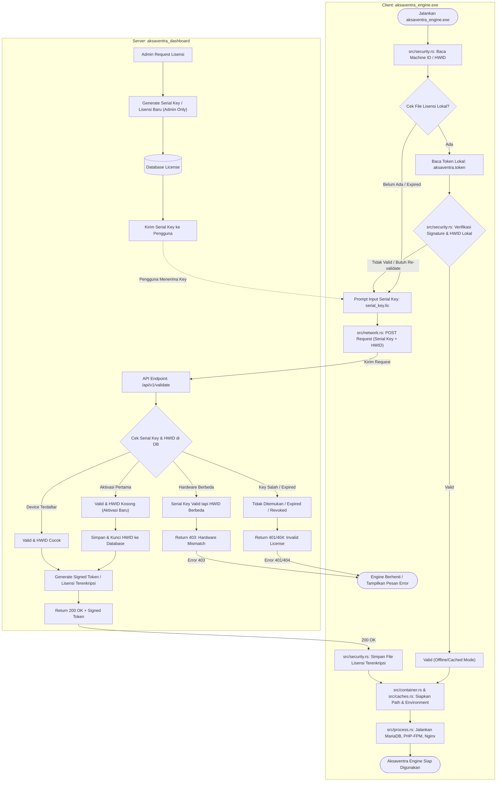

# Project Planning: Aksaventra Engine Validation & License Management System

## 1. Project Overview
Proyek **Aksaventra Dashboard & Validation Server** merupakan sistem server manajemen lisensi perangkat, otentikasi dashboard admin terpusat, dan validasi integritas binary untuk aplikasi portabel **`aksaventra_engine.exe`** (penanganan isu keamanan `#39`).

Sistem ini memiliki dua tanggung jawab utama:
1. **Manajemen Lisensi (Admin Only)**:
   - Dashboard admin terproteksi khusus untuk membuat serial key baru, menetapkan durasi/masa berlaku, mengikat penguncian perangkat keras (**Hardware ID / HWID**), memantau log aktivitas, dan mencabut status lisensi (*revocation*).
2. **Server Validasi Lisensi & Binary Engine**:
   - Menyediakan API endpoint `/api/v1/validate` bagi `aksaventra_engine.exe` untuk memvalidasi lisensi berdasarkan **Serial Key** dan penguncian perangkat keras (**HWID / Machine ID**).
   - Menghasilkan token terenkripsi bertanda tangan kriptografis (*Signed License Token*) yang memungkinkan klien engine berjalan dalam mode offline terverifikasi (*Cached Mode*).

---

## 2. Alur Sistem Validasi Lisensi & Engine (Architecture Flowchart)



---

## 3. Logika Verifikasi Lisensi (State Machine)

| Kasus | Kondisi Server | Respon HTTP | Tindakan Server | Respon Klien (`aksaventra_engine.exe`) |
| :--- | :--- | :--- | :--- | :--- |
| **1. Aktivasi Baru** | Serial Key valid, status `ACTIVE`, HWID masih kosong (`NULL`) | `200 OK` | Mengunci HWID perangkat klien ke database & menerbitkan Signed Token | Klien menyimpan token terenkripsi (`aksaventra.token`), menyiapkan environment, dan menjalankan engine |
| **2. Device Terdaftar** | Serial Key valid, status `ACTIVE`, HWID cocok dengan database | `200 OK` | Menerbitkan Signed Token / memperbarui session token | Klien memperbarui cache token lokal dan melanjutkan engine runtime |
| **3. Invalid / Revoked** | Serial Key tidak ditemukan, status `REVOKED`, atau masa aktif telah berakhir (`EXPIRED`) | `401 Unauthorized` / `404 Not Found` | Mencatat log penolakan di audit trail | Klien menghapus token lokal, menampilkan error *"Lisensi Ditolak"* dan proses berhenti |
| **4. Hardware Mismatch** | Serial Key valid dan terdaftar, namun HWID klien tidak cocok dengan HWID yang terkunci | `403 Forbidden` | Mencatat indikasi duplikasi lisensi di audit security | Klien menampilkan error *"Hardware Mismatch / Lisensi terikat pada perangkat lain"* dan proses berhenti |

---

## 4. Struktur Proyek Nyata (Current Project Architecture)

Struktur direktori saat ini diatur secara presisi mematuhi prinsip Hexagonal Architecture, Framework-Agnostic Core Kernel, dan Bounded Contexts:

```text
├── prisma/
│   ├── migrations/                      # Riwayat migrasi skema database PostgreSQL
│   ├── seed/                            # Seeding modular per domain
│   │   ├── data/                        # Data mentah (.ts / .csv) untuk seeding
│   │   ├── lib/                         # Utilitas seeding (csv reader, mapper)
│   │   ├── logs/                        # Log audit status seeding
│   │   ├── seeders/                     # Eksekutor seeder per entitas
│   │   └── seed.ts                      # Entrypoint runner seeding
│   └── schema.prisma                    # Skema utama Prisma v7 ORM
│
├── src/
│   ├── app/                             # Next.js App Router (Routing & Entrypoints)
│   │   ├── (protected)/                 # Route Group: Dashboard terproteksi RBAC
│   │   │   ├── dashboard/
│   │   │   │   ├── licenses/            # Manajemen Serial Key & Lisensi (Admin Only)
│   │   │   │   │   ├── [id]/page.tsx    # Detail Lisensi & Status HWID
│   │   │   │   │   ├── create/page.tsx  # Form Penerbitan Lisensi Baru
│   │   │   │   │   └── page.tsx         # Daftar & Filter Lisensi
│   │   │   │   ├── engines/             # Registri Versi & Integritas Hash Biner (Isu #39)
│   │   │   │   └── page.tsx             # Ringkasan Metrik Dashboard
│   │   │   └── layout.tsx               # Protected Layout (AppLayout, AppSidebar, AppTopbar)
│   │   ├── (public)/                    # Route Group: Autentikasi Publik
│   │   │   ├── login/page.tsx
│   │   │   ├── register/page.tsx
│   │   │   ├── forgot-password/page.tsx
│   │   │   ├── reset-password/page.tsx
│   │   │   └── verify-email/page.tsx
│   │   ├── api/                         # Next.js REST API Route Handlers
│   │   │   ├── v1/
│   │   │   │   └── validate/
│   │   │   │       └── route.ts         # Endpoint Validasi Lisensi Klien (aksaventra_engine.exe)
│   │   │   ├── auth/                    # Endpoint API Autentikasi Internal
│   │   │   └── licenses/                # Endpoint CRUD Lisensi (Admin Only)
│   │   │       ├── [id]/route.ts
│   │   │       ├── _factory.ts          # Dependency Injection (DI) Assembler
│   │   │       └── route.ts
│   │   ├── layout.tsx                   # Root Layout (Font Plus Jakarta Sans & Toast Provider)
│   │   └── page.tsx                     # Root Redirector (/dashboard atau /login)
│   │
│   ├── core/                            # Kernel Inti Arsitektur (Framework-Agnostic)
│   │   ├── application/                 # Base Abstraksi Use Case & Services
│   │   │   ├── BaseService.ts           # Facade orchestrator dengan method execute()
│   │   │   ├── BaseUseCase.ts           # Kontrak eksekusi use case
│   │   │   ├── BaseUploadUseCase.ts     # Abstraksi penanganan upload berkas
│   │   │   ├── auth/                    # Shared Auth ports & decorators
│   │   │   ├── dto/                     # Base DTO & Pagination kontrak
│   │   │   ├── errors/                  # Application level error handlers
│   │   │   └── ports/                   # Abstract driver ports
│   │   ├── domain/                      # Base Domain Abstractions
│   │   │   ├── BaseEntity.ts            # Rich Entity model dengan ID & timestamps
│   │   │   ├── BaseRepository.ts        # Kontrak generic repository CRUD
│   │   │   ├── BaseValueObject.ts       # Immutable Value Object base
│   │   │   ├── Result.ts                # Railway-Oriented Programming (Result<T, E>)
│   │   │   └── errors/                  # Domain-specific errors
│   │   ├── http/                        # Base HTTP Controllers & Responses
│   │   │   ├── BaseController.ts        # Base controller Next.js Route Handlers
│   │   │   ├── HttpResultHandler.ts     # Pemetaan Result<T, E> ke NextResponse
│   │   │   ├── QueryParams.ts           # Parser parameter pagination & filtering
│   │   │   ├── RouteParamHelper.ts      # Ekstraksi dynamic params Next.js
│   │   │   ├── errors/                  # HTTP Errors
│   │   │   ├── response/                # Formatter respons standar API
│   │   │   └── validation/              # Request payload validation helper
│   │   ├── infrastructure/              # Base Infrastructure Adapters
│   │   │   ├── adapters/                # Adapter generic
│   │   │   ├── context/                 # Execution context
│   │   │   └── storage/                 # Adapter penyimpanan berkas
│   │   ├── libs/                        # Core Shared Libraries
│   │   │   └── prisma.ts                # Singleton instance Prisma Client
│   │   └── shared/                      # Core Environment & Global Utilities
│   │       ├── env.ts                   # Validasi variabel lingkungan
│   │       ├── types/                   # Type utilities global (DeepPartial, dll)
│   │       └── utils/                   # Helper murni framework-agnostic
│   │
│   ├── libs/                            # Global External Configuration & Server Helpers
│   │   ├── enums.ts                     # Definisi Enum Global (UserRole, EngineStatus)
│   │   ├── providers/                   # Context Provider UI (AppToastProvider.tsx)
│   │   ├── serverLog.ts                 # Logger aman server & proxy gateway
│   │   └── utils.ts                     # Formatters & redirectByRole helpers
│   │
│   ├── modules/                         # BOUNDED CONTEXTS (DDD Modules)
│   │   ├── auth/                        # Modul Autentikasi Pengguna & Sesi Admin
│   │   │   ├── application/
│   │   │   │   ├── services/
│   │   │   │   │   └── AuthServices.ts  # Application Facade & UseCase Orchestrator
│   │   │   │   └── usecase/             # 16 use case otentikasi & audit log
│   │   │   ├── domain/
│   │   │   │   ├── builders/            # AuthQueryBuilder.ts
│   │   │   │   ├── dto/                 # AuthRequestDTO.ts, AuthResponseDTO.ts
│   │   │   │   ├── entity/              # UserCredentialEntity.ts, UserSessionEntity.ts, dll
│   │   │   │   ├── interfaces/          # AuthInterfaces, PasswordHasher, TokenProvider
│   │   │   │   ├── mapper/              # AuthMapper.ts
│   │   │   │   ├── rules/               # PasswordPolicy, AccountLock, RegisterPolicy
│   │   │   │   ├── types/               # AuthJwtPayload, CurrentAuth, SessionPayload
│   │   │   │   └── value-object/        # AccessToken, RefreshToken, SessionFingerprint
│   │   │   ├── infrastructure/
│   │   │   │   ├── decorator/           # getCurrentAuth.ts, withAuthContext.ts
│   │   │   │   ├── http/                # AuthController.ts
│   │   │   │   ├── providers/           # ArgonProvider (argon2), JwtProvider (jose), CookieManager
│   │   │   │   ├── repo/                # AuthRepository.ts
│   │   │   │   └── validators/          # auth.validator.ts (Zod schemas)
│   │   │   ├── presentation/
│   │   │   │   ├── helpers/             # authCookieHelper, authUserMapper
│   │   │   │   └── hooks/               # useAuthApi.ts
│   │   │   ├── shared/
│   │   │   │   ├── constants/           # authCookie.ts (AUTH_COOKIE keys)
│   │   │   │   └── server/              # serverAuth.ts (getCurrentUser SSR)
│   │   │   └── tests/                   # 14 test suite komprehensif Vitest Triple A
│   │   │
│   │   ├── licenses/                    # Modul Manajemen Lisensi & Validasi HWID
│   │   │   ├── application/
│   │   │   │   ├── services/LicenseServices.ts
│   │   │   │   └── usecase/
│   │   │   │       ├── GenerateLicenseUseCase.ts
│   │   │   │       ├── ValidateEngineLicenseUseCase.ts
│   │   │   │       ├── RevokeLicenseUseCase.ts
│   │   │   │       └── GetLicenseByIdUseCase.ts
│   │   │   ├── domain/
│   │   │   │   ├── entity/LicenseEntity.ts
│   │   │   │   ├── interfaces/LicenseInterfaces.ts
│   │   │   │   ├── value-object/SerialKey.ts, HardwareId.ts
│   │   │   │   └── dto/LicenseRequestDTO.ts, LicenseResponseDTO.ts
│   │   │   ├── infrastructure/
│   │   │   │   ├── repo/LicenseRepository.ts
│   │   │   │   ├── http/LicenseController.ts
│   │   │   │   └── validators/license.validator.ts
│   │   │   └── presentation/hooks/useLicenseApi.ts
│   │   │
│   │   └── engines/                     # Modul Registri Binary Engine (Isu #39)
│   │       ├── application/usecase/ValidateEngineHashUseCase.ts
│   │       ├── domain/entity/EngineValidationEntity.ts
│   │       └── infrastructure/repo/EngineValidationRepository.ts
│   │
│   ├── sections/                        # ATOMIC DESIGN UI (Tampilan Per Modul)
│   │   ├── licenses/
│   │   │   ├── atomic/                  # LicenseStatusBadge, LicenseKeyField
│   │   │   ├── molecules/               # LicenseTableView, LicenseDetailCard, LicenseFormView
│   │   │   ├── organisms/               # LicenseListView, CreateLicenseView, LicenseDetailView
│   │   │   └── pages/                   # LicenseSection.tsx, CreateLicenseSection.tsx
│   │   └── engines/
│   │       ├── atomic/                  # HashStatusBadge.tsx, VersionPill.tsx
│   │       └── molecules/               # EngineVersionTable.tsx
│   │
│   ├── security/                        # Engine Otorisasi, Matriks RBAC & Policy
│   │   ├── AvatarMenu.ts                # Metadata profil & menu pengguna
│   │   ├── Permissions.ts               # Enumerasi hak akses
│   │   ├── fieldGuard.ts                # AuthContext, canAccessRoute, canAccessApi
│   │   ├── policyEngine.ts              # Evaluasi kebijakan akses lisensi (Admin-only)
│   │   ├── rbacConfig.ts                # Matriks Role-Based Access Control
│   │   ├── sidebar/                     # Generator menu navigasi terfilter izin
│   │   └── tests/                       # Unit test: fieldGuard, policyEngine, proxy
│   │
│   ├── shared-ui/                       # DESIGN SYSTEM GLOBAL (Reusable Primitives)
│   │   ├── component/                   # Button, Table, Modal, Form, Grid, Inputs
│   │   └── layout/                      # AppLayout, AppSidebar, AppTopbar
│   │
│   ├── styles/
│   │   └── globals.css                  # Tailwind CSS v4.3 & Plus Jakarta Sans typography
│   └── proxy.ts                         # Edge Gateway Middleware resmi Next.js 16
│
├── biome.json                           # Konfigurasi Linter & Formatter Biome
├── next.config.ts                       # Konfigurasi Next.js 16 (Turbopack)
├── prisma.config.ts                     # Konfigurasi Prisma 7
├── tsconfig.json                        # Konfigurasi TypeScript & Path Aliases (@/* -> ./src/*)
└── vitest.config.ts                     # Konfigurasi Vitest TDD Test Runner
```

---

## 5. Milestone & Rencana Implementasi

### Phase 1: Inisialisasi, Core Kernel, & Security Edge Gateway (Selesai)
- [x] Pembangunan kernel arsitektur framework-agnostic (`src/core/application`, `src/core/domain`, `src/core/http`).
- [x] Implementasi Edge Gateway `src/proxy.ts` Next.js 16 untuk rute validasi engine dan proteksi auth dashboard.
- [x] Migrasi pustaka keamanan modern: `jose` (JWT) dan `argon2` (Argon2id).
- [x] Modul autentikasi hexagonal (`src/modules/auth`) lengkap dengan 16 use cases, entity, rules, dan providers.
- [x] Pengujian unit TDD komprehensif Triple A (94 tests passed, 100% lolos).

### Phase 2: Modul Manajemen Lisensi & Skema Prisma (Sedang Berjalan)
- [ ] Penambahan model Prisma `License` pada `prisma/schema.prisma`.
- [ ] Implementasi modul `src/modules/licenses/`:
  - Domain: `LicenseEntity`, Value Object `SerialKey`, `HardwareId`, `LicenseMapper`.
  - Application: `GenerateLicenseUseCase` (Admin only), `RevokeLicenseUseCase`, `GetLicenseByIdUseCase`, `LicenseServices`.
  - Infrastructure: `LicenseRepository`, `LicenseController`, `license.validator.ts`.
  - Presentation: `useLicenseApi.ts`.

### Phase 3: Engine Validation Endpoint & Signed Token Pipeline
- [ ] Implementasi API Route `POST /api/v1/validate` via `src/app/api/v1/validate/route.ts`.
- [ ] Implementasi `ValidateEngineLicenseUseCase` (pengecekan 4 kondisi: aktivasi baru, HWID match, hardware mismatch, expired/revoked).
- [ ] Format respon JSON kompatibel dengan klien `aksaventra_engine.exe` (`src/security.rs`):
  - `valid`: boolean
  - `message`: string
  - `client_name`: string
  - `vault_secret`: string
  - `expires_at`: timestamp unix detik

### Phase 4: Atomic UI Sections & Dashboard Manajemen Lisensi
- [ ] Pembuatan komponen UI Atomic pada `src/sections/licenses/`:
  - `atomic/`, `molecules/`, `organisms/`, `pages/`.
- [ ] Pemasangan halaman terproteksi pada `src/app/(protected)/dashboard/licenses/`.
- [ ] Verifikasi QA, Security Audit, dan End-to-End TDD.