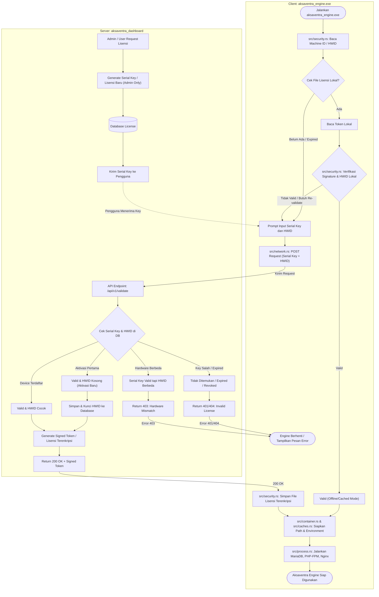

# Project Planning: Aksaventra Engine Validation & License Management System

## 1. Project Overview
Proyek **Aksaventra Dashboard & Validation Server** merupakan sistem otentikasi, manajemen lisensi, dan validasi integritas binary untuk aplikasi portabel **`aksaventra_engine.exe`** (isu keamanan `#39`).

Sistem ini memiliki dua tanggung jawab utama:
1. **Manajemen Lisensi (Admin Only)**:
   - Dashboard admin terproteksi khusus untuk membuat, memperbarui, membatasi masa berlaku, dan mencabut serial key / lisensi perangkat.
2. **Server Validasi Lisensi & Binary Engine**:
   - Menyediakan API endpoint `/api/v1/validate` bagi `aksaventra_engine.exe` untuk memvalidasi lisensi berdasarkan **Serial Key** dan penguncian perangkat keras (**HWID / Machine ID**).
   - Menghasilkan token terenkripsi/bertanda tangan kriptografis (*Signed License Token*) yang memungkinkan klien engine berjalan dalam mode offline terverifikasi.

---

## 2. Alur Sistem Validasi Lisensi & Engine (Architecture Flowchart)

Berikut adalah diagram alur interaksi antara klien binary `aksaventra_engine.exe` dengan server `aksaventra_dashboard`:

---

## 3. Logika & Kondisi Verifikasi Lisensi (State Machine)

| Kasus | Kondisi Server | Respon HTTP | Tindakan Server | Respon Klien (`aksaventra_engine.exe`) |
| :--- | :--- | :--- | :--- | :--- |
| **1. Aktivasi Baru** | Serial Key valid, status `ACTIVE`, HWID masih kosong (`NULL`) | `200 OK` | Mengunci HWID perangkat klien ke database & menerbitkan Signed Token | Klien menyimpan token terenkripsi, menyiapkan environment, dan menjalankan engine |
| **2. Device Terdaftar** | Serial Key valid, status `ACTIVE`, HWID cocok dengan database | `200 OK` | Menerbitkan Signed Token / memperpanjang session token | Klien memperbarui cache token lokal dan melanjutkan engine runtime |
| **3. Invalid / Revoked** | Serial Key tidak ditemukan, status `REVOKED`, atau masa aktif telah berakhir (`EXPIRED`) | `401 Unauthorized` / `404 Not Found` | Mencatat log penolakan di audit trail | Klien menampilkan error: *"Lisensi tidak valid atau telah berakhir"* dan proses berhenti |
| **4. Hardware Mismatch** | Serial Key valid dan terdaftar, namun HWID klien tidak cocok dengan HWID yang terkunci | `403 Forbidden` | Mencatat indikasi duplikasi lisensi di audit security | Klien menampilkan error: *"Hardware Mismatch / Lisensi terikat pada perangkat lain"* dan proses berhenti |

---

## 4. Tech Stack & Standar Arsitektur

- **Framework Web & API**: Next.js 16.4.3+ (App Router dengan `src/proxy.ts` Edge Gateway)
- **Bahasa**: TypeScript (Strict Type Safety)
- **Database & ORM**: PostgreSQL & Prisma v7
- **Styling**: Tailwind CSS v4.3 (Modern Slate & Emerald aesthetic)
- **Security & Kriptografi**:
  - `jose`: Penandatanganan token JWT / Signed License Token
  - `argon2`: Password hashing akun admin
  - Algoritma SHA-256 / HMAC untuk validasi signature integritas binary engine
- **Pola Arsitektur**: Hexagonal Architecture (Domain, Application Use Cases, Infrastructure Adapters, Presentation)
- **Metodologi Pengujian**: Test-Driven Development (TDD) dengan pola **Triple A (Arrange, Act, Assert)** menggunakan Vitest (target cakupan > 80%).

---

## 5. Milestone & Rencana Implementasi

### Phase 1: Inisialisasi, Core Domain & Security Edge Gateway (Selesai)
- [x] Setup struktur direktori Hexagonal Architecture (`src/core`, `src/modules/auth`, `src/security`).
- [x] Implementasi Edge Gateway `src/proxy.ts` dengan deteksi rute API engine & otentikasi dashboard.
- [x] Migrasi modul keamanan ke standar modern `jose` (JWT) dan `argon2` (Argon2id).
- [x] Unit test TDD untuk lapisan Domain, Auth Services, Provider, dan Security Guard (94 tests passed).

### Phase 2: Skema Lisensi Prisma & Modul Manajemen Lisensi (Sedang Berjalan)
- [ ] Penambahan model Prisma `License` (id, serialKey, clientName, hwid, maxDevices, status, expiresAt, createdAt, updatedAt).
- [ ] Implementasi Domain Entity `LicenseEntity` dan Value Object `SerialKey`, `HardwareId`.
- [ ] Use Case Admin: `GenerateLicenseUseCase`, `RevokeLicenseUseCase`, `FindLicensesUseCase`.
- [ ] Pembatasan otorisasi pembuatan lisensi khusus role `ADMIN`.

### Phase 3: Engine Validation Endpoint & Signed Token Pipeline
- [ ] Implementasi API Route `POST /api/v1/validate` (atau `POST /api/v1/engine/validate`).
- [ ] Use Case: `ValidateEngineLicenseUseCase` (pengecekan 4 kondisi: aktivasi baru, HWID match, hardware mismatch, expired/revoked).
- [ ] Pembuatan `LicenseTokenSigner` untuk menghasilkan file/token lisensi terenkripsi yang kompatibel dengan parser Rust `src/security.rs`.
- [ ] Pencatatan log akses validasi mesin pada `ValidationLog`.

### Phase 4: UI Admin Dashboard & Pemantauan Engine
- [ ] Halaman pembuatan dan daftar lisensi `/dashboard/licenses`.
- [ ] Antarmuka manajemen versi binary engine dan monitoring status keamanan (Isu `#39`).
- [ ] Indikator status real-time untuk lisensi aktif, expired, dan hardware mismatch.
- [ ] Verifikasi QA & Security Audit komprehensif.